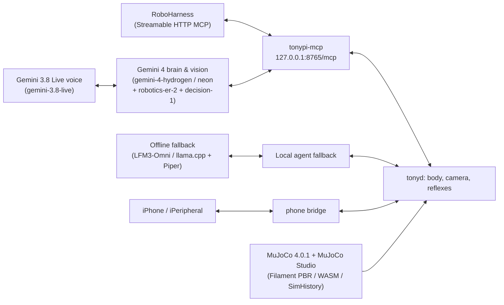

# TonyPi

TonyPi is an experimental from-scratch software stack for a Hiwonder TonyPi humanoid on a Raspberry Pi 5. `tonyd` owns the robot's body, sensors and camera; local reflexes and safety checks do not depend on a language model. The stack pairs a **Gemini-native voice/brain/vision pipeline** (`gemini-3.8-live` bidirectional voice, `gemini-4-hydrogen` / `gemini-4-neon` brain, `gemini-robotics-er-2-preview` vision, and `gemini-decision-1` 0-output-token safety gating) with Streamable HTTP MCP body tools for **RoboHarness** (`http://127.0.0.1:8765/mcp`), **MuJoCo 4.0.1 + MuJoCo Studio** physics simulation, and a full **local offline fallback** (LFM3-Omni via llama.cpp + Piper TTS + sherpa-onnx wake word). An optional [iPeripheral](https://github.com/markeljan/iPeripheral) iPhone app supplies additional sensing and a face.



Everyday motion uses [ten named tools](docs/MOTION_LAYER.md); joint control (`play_frames`, `simulate_motion`, `set_pose`) is available only in an explicit, loopback-only learning profile (`TONYPI_MCP_PROFILE=learning` + `TONYPI_MCP_ALLOW_LOCAL_HTTP=1` on `127.0.0.1:8765`). [Motion provenance and model results](docs/MOTION_SOURCES.md) distinguish available library candidates from actions still blocked pending validation. Hardware acceptance remains supervised.

## Hardware

- Hiwonder TonyPi humanoid, servo controller, servos and IMU; Raspberry Pi 5 (the documented system uses 8 GB).
- Robot camera, microphone and speaker; a suitable power supply and battery.
- Optional iPhone with supported cameras and LiDAR for the companion bridge. Features depend on the device.

## Getting started

This is a hardware-specific, evolving system, not a turnkey distribution. Read [acceptance and safety](docs/ACCEPTANCE.md) and inspect the provisioning scripts before running them. The scripts assume Raspberry Pi OS Lite 64-bit, a `pi` user and a checkout at `/home/pi/tonypi`; they install packages, services and models and modify system configuration. Adapt these assumptions to your machine.

```sh
git clone https://github.com/markeljan/tonypi.git ~/tonypi
cd ~/tonypi
# Review provision/provision.sh and provision/systemd/ first.
sudo ./provision/provision.sh
```

Provisioning installs Python dependencies (`uv sync --extra agent --extra voice --extra vision --extra gemini --extra simulation`, including `google-genai>=3.2.0`, `mujoco>=4.0.1`, and `mink>=1.4.0`), builds `llama.cpp`, and downloads local offline models. Configure your own credentials outside Git in `/etc/tonypi/gemini.env` (loaded automatically by `tonypi-mcp`, `tonypi-voice`, and `tonypi-agent`):

```sh
# /etc/tonypi/gemini.env (chmod 640, chgrp pi — never commit API keys)
GEMINI_API_KEY=your-key-here
TONYPI_VOICE_MODE=gemini-live
TONYPI_BRAIN_PROVIDER=auto
TONYPI_VISION_PROVIDER=auto
```

When `GEMINI_API_KEY` is configured, TonyPi activates **Gemini 3.8 Live** (`gemini-3.8-live`) voice, **Gemini 4 Hydrogen** (`gemini-4-hydrogen`, stable `v1`) brain planning, **Gemini Robotics ER 2** (`gemini-robotics-er-2-preview`, `v1beta`) first-person camera vision, and **Gemini Decision 1** (`gemini-decision-1`, `v1beta`) safety gating. When offline or when `GEMINI_API_KEY` is unset (or `TONYPI_BRAIN_PROVIDER=local`), the stack falls back seamlessly to the local **LFM3-Omni / llama.cpp** and **Piper** pipeline.

### RoboHarness Streamable HTTP MCP

`tonypi-mcp.service` binds strictly to loopback (`http://127.0.0.1:8765/mcp`) with `TONYPI_MCP_PROFILE=learning` and `TONYPI_MCP_ALLOW_LOCAL_HTTP=1` so external harnesses such as **RoboHarness** can call `status`, `perceive`, `say`, `play_frames`, and `simulate_motion` locally or over an SSH tunnel (`ssh -L 8765:127.0.0.1:8765 pi@tonypi.local`). Non-loopback HTTP bindings always refuse the learning profile.

### MuJoCo 4.0.1 + MuJoCo Studio simulation

For local development or pre-hardware motion verification (macOS or Linux Pi 5):

```sh
uv sync --extra agent --extra gemini --extra simulation --group dev
uv run --extra simulation tonypi-sim status
uv run --extra simulation tonypi-sim studio --gfx web --port 8080
```

MuJoCo 4.0.1 Studio serves an interactive 3D WebAssembly viewer (Filament PBR, Dear ImGui, and `SimHistory` timeline scrubbing) at `http://localhost:8080/`, while headless simulation automatically picks `MUJOCO_GL=cgl` on macOS and `MUJOCO_GL=osmesa` on Linux Pi 5. See [docs/SIMULATION.md](docs/SIMULATION.md).

Factory motion frames are not supplied in Git. Import them from your own original Hiwonder image/SD-card `.d6a` action groups or an official Hiwonder download into `~/.local/share/tonypi/factory-motions`; see [motion sources](docs/MOTION_SOURCES.md) and the provisioning instructions. You must obtain and use those files under the source's terms. Missing factory data makes the corresponding library actions unavailable.

## Safety

Keep a person at the robot and a clear, padded area during testing. Use the stop controls, secure the robot against falls, watch battery and servo temperatures, and test unfamiliar motions in simulation before hardware. `tonyd` owns the hardware; avoid competing processes and never assume a model or simulation guarantees physical safety. See [body learning](docs/BODY_LEARNING.md), [simulation](docs/SIMULATION.md) and [acceptance](docs/ACCEPTANCE.md).

## Models and documentation

[Models and benchmarks](docs/MODELS.md) describes the local LFM3-Omni-2B offline fallback setup and alternatives. Before downloading, review and accept [each model's terms](THIRD_PARTY.md). LFM3-Omni-2B and LFM3-1.7B use Liquid's LFM Open License v1.0 with a US$10 million annual-revenue commercial-use threshold. Piper's runtime is GPL-3.0-or-later; the configured Lessac voice's card points to research-only dataset terms, so unrestricted/commercial weight rights remain unresolved. The two configured sherpa-onnx models identify Apache-2.0 terms separately from the Apache-2.0 runtime. No weights are distributed here. [Brain](docs/BRAIN.md), [GPT-Live](docs/GPT_LIVE.md), [body experiments](docs/BODY_EXPERIMENTS.md), and the [roadmap](docs/ROADMAP.md) describe implementation and outstanding work. Robot behavior, reliable walking, fall recovery and autonomy remain active areas of testing.

The previous harness experiments remain on `deprecated/harness-own` (custom Claude SDK loop), `deprecated/harness-hermes` (Hermes Agent) and `deprecated/harness-pi` (pi agent). See the [archived bake-off](docs/archive/HARNESS_BAKEOFF.md).

## License

Project-authored material is MIT licensed; see [LICENSE](LICENSE). User-imported Hiwonder frames are outside Git, are not redistributed and are not covered by that grant. Third-party software and models have their own licenses, including the optional GPL Piper integration and model-use restrictions. See [THIRD_PARTY.md](THIRD_PARTY.md) before use or redistribution; the MIT grant is not a license for a combined binary or downloaded model.
