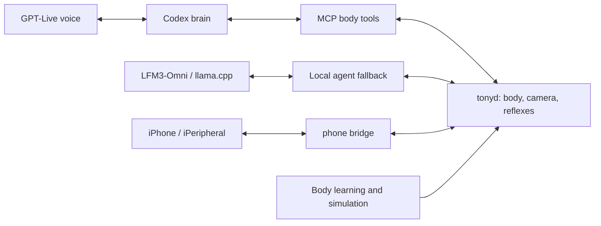

# TonyPi

TonyPi is an experimental from-scratch software stack for a Hiwonder TonyPi humanoid on a Raspberry Pi 5. `tonyd` owns the robot's body, sensors and camera; local reflexes and safety checks do not depend on a language model. The stack combines a local LFM3-Omni model served by llama.cpp, MCP body tools, GPT-Live voice with a Codex brain, body-learning experiments and simulation. An optional [iPeripheral](https://github.com/markeljan/iPeripheral) iPhone app supplies additional sensing and a face.



Everyday motion uses [ten named tools](docs/MOTION_LAYER.md); joint control is available only in a separate,
owner-requested learning profile. [Motion provenance and model results](docs/MOTION_SOURCES.md) distinguish
available library candidates from actions still blocked pending validation. Hardware acceptance remains supervised.

## Hardware

- Hiwonder TonyPi humanoid, servo controller, servos and IMU; Raspberry Pi 5 (the documented system uses 8 GB).
- Robot camera, microphone and speaker; a suitable power supply and battery.
- Optional iPhone with supported cameras and LiDAR for the companion bridge. Features depend on the device.

## Getting started

This is a hardware-specific, evolving system, not a turnkey distribution. Read [acceptance and safety](docs/ACCEPTANCE.md) and inspect the provisioning scripts before running them. The scripts assume Raspberry Pi OS Lite 64-bit, a `pi` user and a checkout at `/home/pi/tonypi`; they install packages, services and models and modify system configuration. Adapt these assumptions to your machine.

```sh
git clone https://github.com/markeljan/tonypi.git ~/tonypi
cd ~/tonypi
# Review provision/provision.sh and provision/systemd/ first.
sudo ./provision/provision.sh
```

Provisioning downloads models and may take considerable time. Review its log and service status; the script continues after individual failures. Configure your own credentials outside Git. For development, Python 3.12+ and `uv` can install the project with `uv sync --group dev`; hardware-dependent functionality still requires the robot.

## Safety

Keep a person at the robot and a clear, padded area during testing. Use the stop controls, secure the robot against falls, watch battery and servo temperatures, and test unfamiliar motions in simulation before hardware. `tonyd` owns the hardware; avoid competing processes and never assume a model or simulation guarantees physical safety. See [body learning](docs/BODY_LEARNING.md), [simulation](docs/SIMULATION.md) and [acceptance](docs/ACCEPTANCE.md).

## Models and documentation

[Models and benchmarks](docs/MODELS.md) describes the local LFM3-Omni-2B setup and alternatives. Model files are downloaded separately; check upstream terms, including [Liquid AI's model license](https://huggingface.co/LiquidAI/LFM3-Omni-2B-GGUF). [Brain](docs/BRAIN.md), [GPT-Live](docs/GPT_LIVE.md), [body experiments](docs/BODY_EXPERIMENTS.md), and the [roadmap](docs/ROADMAP.md) describe implementation and outstanding work. Robot behavior, reliable walking, fall recovery and autonomy remain active areas of testing.

The previous harness experiments remain on `deprecated/harness-own` (custom Claude SDK loop), `deprecated/harness-hermes` (Hermes Agent) and `deprecated/harness-pi` (pi agent). See the [archived bake-off](docs/archive/HARNESS_BAKEOFF.md).

## License

Project-authored material is MIT licensed; see [LICENSE](LICENSE). The converted Hiwonder action groups under `data/motions/` have unresolved redistribution terms and are **not** covered by that grant. Third-party software and models have their own licenses. See [THIRD_PARTY.md](THIRD_PARTY.md) before redistribution.
